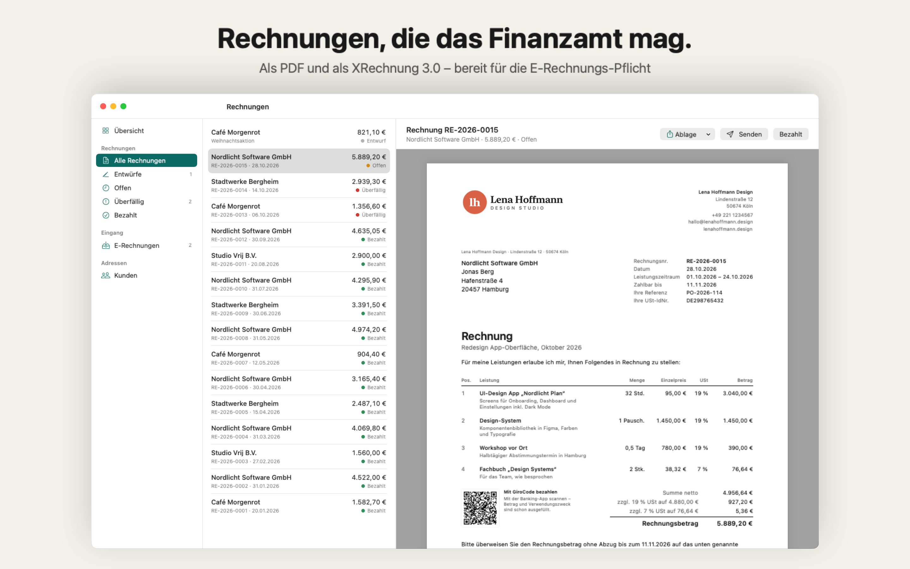

# Rechnungsklar

**E-Rechnungen schreiben und lesen, einfach und direkt auf dem Mac.**

Native macOS-App (SwiftUI, macOS 14+) für Selbstständige und kleine Unternehmen, die von der deutschen
E-Rechnungs-Pflicht betroffen sind. Rechnungen gibt es als PDF und als XRechnung 3.0. Empfangene XRechnungen,
ZUGFeRD- und Factur-X-Dateien zeigt die App lesbar an und macht sie per GiroCode bezahlbar.



- **Konzept, Markt, Preise, Umsatzrechnung:** [docs/KONZEPT.md](docs/KONZEPT.md)
- **Schritt für Schritt in den App Store:** [docs/APP-STORE.md](docs/APP-STORE.md)
- **Beispiel-Ausgaben:** [docs/beispiele](docs/beispiele) (PDF und XRechnungen)
- **Werbeclip für Instagram Reels (30 s, 1080 × 1920):** [Marketing/Rechnungsklar-Reel.mp4](Marketing/Rechnungsklar-Reel.mp4),
  mit eigens synthetisierter, lizenzfreier Musik (`Marketing/Clip/Music.swift`, 125 BPM, auf die Schnitte getimt;
  der Track allein: `Marketing/Rechnungsklar-Musik.wav`). Neu erzeugen mit `./Marketing/make-clip.sh`

## Starten

```bash
./build.sh
```
```bash
open build/Rechnungsklar.app
```

`./build.sh` braucht nur die Xcode Command Line Tools. `UNIVERSAL=1 ./build.sh` baut für Apple Silicon und Intel,
`DEBUG=1 ./build.sh` einen Entwickler-Build. Den kannst du mit `--pro` starten, dann ist Pro ohne Kauf freigeschaltet.

## Prüfen

```bash
./test.sh
```
- Rechenlogik (Rundung je Steuersatz), Pflichtangaben, IBAN-Prüfziffer
- XRechnung schreiben → wieder einlesen (regulär, Kleinunternehmer, Reverse Charge, Sonderzeichen)
- GiroCode: eigener QR-Encoder, gegengeprüft mit einem unabhängigen Decoder (`Tests/QRTest/decode.py`)
- Optional `KOSIT_DIR=…` (und `JAVA=…`): offizielle Validierung mit dem KoSIT-Validator

**Stand 1.11.2026:** Alle erzeugten XRechnungen (regulär mit 19 % und 7 %, Kleinunternehmer ohne USt-IdNr., Reverse Charge,
Leistungszeitraum, Beispielrechnung) sind laut KoSIT-Validator 1.6.3 mit XRechnung-Konfiguration 3.0.2 (2026-08-31)
**ACCEPTABLE, ohne Fehler und ohne Warnungen**. Berichte: [docs/beispiele/kosit-berichte](docs/beispiele/kosit-berichte).

## Aufbau

| Datei | Inhalt |
|---|---|
| `Sources/Models.swift` | Firma, Kunde, Rechnung, Positionen, Steuerlogik, Eingangsrechnung |
| `Sources/XRechnungWriter.swift` | XRechnung 3.0 (UN/CEFACT CII) erzeugen |
| `Sources/EInvoiceReader.swift` | CII, UBL und ZUGFeRD/Factur-X-PDFs (eingebettete XML) lesen |
| `Sources/InvoiceCheck.swift` | Pflichtangaben-Prüfung (§ 14 UStG, BR-DE-Regeln), IBAN |
| `Sources/InvoiceDocument.swift` | A4-Layout, Seitenumbruch, PDF-Export |
| `Sources/QRCode.swift` | QR-Encoder für den GiroCode (Vektorgrafik) |
| `Sources/Store.swift` | lokale Datenhaltung (JSON im App-Container), Archiv, CSV |
| `Sources/Purchases.swift` | StoreKit 2: Abo und Einmalkauf, Freikontingent |
| `Sources/*View.swift` | Oberfläche |
| `Resources/` | Info.plist, Sandbox-Berechtigungen, Datenschutz-Manifest, Symbol, StoreKit-Testdatei |
| `Tests/Shots` | rendert Screenshots und App-Store-Bilder (`build/shots`) |
